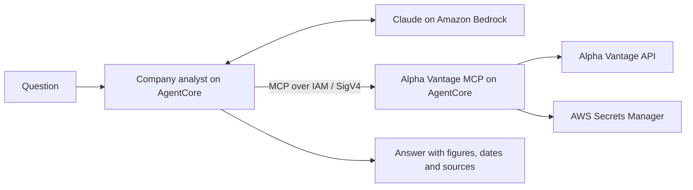

# Company analysis with AgentCore and MCP

A small end-to-end example of an AI agent answering questions about a company's stock price, P&L, growth, P/E, and cash flow. Both services are adapted from [bedrock-agent-blueprint](https://github.com/weijianzhg/bedrock-agent-blueprint/tree/c65654ff433f8e9cbc8b916a3a579497a93537dc).



The agent gets financial data only through MCP. The MCP server exposes six tools: stock quote, company overview, income statement, balance sheet, cash flow, and a combined snapshot. Financial ratios are calculated in Python; the model explains the returned figures. Each question is independent.

| Directory | What it contains |
| --- | --- |
| [company-agent](company-agent/) | Strands agent, HTTP entry point, and its Terraform |
| [alpha-vantage-mcp](alpha-vantage-mcp/) | MCP tools, Alpha Vantage client, financial calculations, and its Terraform |
| [cloud](cloud/) | AWS image builds, secret setup, and end-to-end verification |

## Deploy to your AWS account

The steps below use **eu-west-1**, **Claude Sonnet 4.6**, and AWS CodeBuild to build ARM64 images. Local Docker is not required. Start with the included **synthetic IBM fixture**, then enable live Alpha Vantage data. Fixture mode still uses the real Bedrock model and both real AgentCore endpoints.

You need:

- Git, [Python 3.11+](https://www.python.org/downloads/), [uv](https://docs.astral.sh/uv/getting-started/installation/), [AWS CLI v2](https://docs.aws.amazon.com/cli/latest/userguide/getting-started-install.html), and [Terraform 1.7+](https://developer.hashicorp.com/terraform/install).
- An AWS profile that can manage AgentCore, Bedrock inference profiles, ECR, CodeBuild, S3, Secrets Manager, CloudWatch Logs, and the IAM roles/policies these resources use, including `iam:PassRole`. Use a development account with the appropriate provisioning permissions.
- Access to `eu.anthropic.claude-sonnet-4-6` in Bedrock. Complete any required Anthropic first-use form and Marketplace activation for your account; see [Bedrock model access](https://docs.aws.amazon.com/bedrock/latest/userguide/model-access.html).

AWS builds, runtime/model calls, and stored resources incur charges. This guide creates one demo using fixed resource names; use a fresh account/region or ensure those names are unused.

### 1. Clone and select your AWS profile

Run all commands from the repository root in the same Bash shell. Replace `your-profile` with your own profile name.

```bash
git clone https://github.com/weijianzhg/company-analysis-demo.git
cd company-analysis-demo

export AWS_PROFILE=your-profile
export AWS_REGION=eu-west-1
export AWS_DEFAULT_REGION="$AWS_REGION"
export TF_VAR_aws_region="$AWS_REGION"

# If this is an AWS IAM Identity Center / SSO profile:
aws sso login --profile "$AWS_PROFILE"

aws sts get-caller-identity
```

Check that the returned account is the one you intend to use. For a non-SSO profile, skip the `aws sso login` line. The scripts use the standard AWS credential chain; no AWS credentials go into the source code.

### 2. Install dependencies and check model access

```bash
uv sync --project company-agent/agents --dev --frozen
uv sync --project alpha-vantage-mcp/mcp_server --dev --frozen

cp company-agent/infra/terraform.tfvars.example company-agent/infra/terraform.tfvars
cp alpha-vantage-mcp/infra/terraform.tfvars.example alpha-vantage-mcp/infra/terraform.tfvars

aws bedrock-runtime converse \
  --model-id eu.anthropic.claude-sonnet-4-6 \
  --messages '[{"role":"user","content":[{"text":"Say hello."}]}]' \
  --inference-config '{"maxTokens":32}' \
  --query 'output.message.content'
```

The model check must return a response before continuing. If you choose a different supported model, also change `model_id` in `company-agent/infra/terraform.tfvars`. The supplied MCP configuration starts with `alpha_vantage_mode = "fixture"`, which needs no Alpha Vantage key.

### 3. Create the image repositories and secret container

```bash
terraform -chdir=alpha-vantage-mcp/infra init
terraform -chdir=company-agent/infra init

terraform -chdir=alpha-vantage-mcp/infra apply \
  -target=aws_ecr_repository.agent \
  -target=aws_ecr_lifecycle_policy.agent \
  -target=aws_secretsmanager_secret.alpha_vantage

terraform -chdir=company-agent/infra apply \
  -target=aws_ecr_repository.agent \
  -target=aws_ecr_lifecycle_policy.agent
```

Review each plan and enter `yes`. These targeted applies only bootstrap the resources needed before the first image build; the full applies happen in step 5. The secret is empty in fixture mode.

### 4. Build both images in AWS

```bash
terraform -chdir=cloud/build init
terraform -chdir=cloud/build apply

uv run --project company-agent/agents --frozen python cloud/build_images.py start --wait
```

Wait for **both builds to succeed**. The script prints a shared image tag such as `cloud-YYYYMMDDHHMMSS`. Set `container_tag` to that exact tag in **both** `infra/terraform.tfvars` files. Keep the other example resource names unchanged; the build configuration looks up those ECR repositories.

If your terminal disconnects, resume checking with:

```bash
uv run --project company-agent/agents --frozen python cloud/build_images.py status --wait
```

### 5. Deploy the MCP endpoint, then the agent

```bash
terraform -chdir=alpha-vantage-mcp/infra apply
terraform -chdir=alpha-vantage-mcp/infra output -raw agent_runtime_arn
```

Copy that ARN into `mcp_runtime_arn` in `company-agent/infra/terraform.tfvars`, then deploy the agent:

```bash
terraform -chdir=company-agent/infra apply
terraform -chdir=company-agent/infra output -raw agent_runtime_arn
```

Terraform creates separate AgentCore runtimes with `DEFAULT` endpoints. Both require IAM authentication. The agent's runtime role can invoke this MCP runtime; the MCP runtime role can read its own API secret. These endpoints are invoked through the signed clients below, rather than opened as web pages.

### 6. Verify the complete flow and ask a question

```bash
uv run --project company-agent/agents --frozen python cloud/test_end_to_end.py --mode fixture

uv run --project company-agent/agents --frozen python company-agent/scripts/invoke.py \
  --prompt "Analyze IBM's P&L, revenue growth, margins, P/E and cash flow."
```

The test checks authentication, discovers all six MCP tools, verifies expected financial calculations, and obtains an actual Bedrock agent response using MCP. It writes results to the ignored `evidence/cloud/` directory. The fixture answer must identify **SYNTHETIC TEST DATA**; expected values include 10% revenue growth, 15% net margin, P/E of 20, and free cash flow of $15 billion.

To inspect MCP without the agent:

```bash
uv run --project alpha-vantage-mcp/mcp_server --frozen python alpha-vantage-mcp/scripts/mcp_client.py --list-tools
```

### 7. Switch to live Alpha Vantage data

Get an [Alpha Vantage API key](https://www.alphavantage.co/support/#api-key) with access to quotes, income statements, balance sheets, and cash flow. Company overview access is also needed for P/E; without it, the agent explicitly reports **P/E unavailable** and analyzes the available statements. The public `demo` key did not provide complete financial statements in our tests.

Store your key in Secrets Manager with the hidden prompt:

```bash
uv run --project company-agent/agents --frozen python cloud/set_api_key.py
```

Change `alpha_vantage_mode = "live"` in `alpha-vantage-mcp/infra/terraform.tfvars`, then:

```bash
terraform -chdir=alpha-vantage-mcp/infra apply

uv run --project company-agent/agents --frozen python cloud/test_end_to_end.py \
  --mode live --allow-missing-overview

uv run --project company-agent/agents --frozen python company-agent/scripts/invoke.py \
  --prompt "Analyze IBM's latest annual performance, P/E and cash flow. Include dates and any missing data."
```

The live command accepts unavailable `OVERVIEW` data, while still requiring a live quote, all three financial statements, usable performance metrics, and an actual agent response using MCP. When overview is missing, the snapshot remains `partial`, all P/E metrics stay `null`, and the agent must say **P/E unavailable**. Other missing datasets still fail the test. Quote currency also remains unknown when the provider does not supply it; statement currency is reported separately. Omit `--allow-missing-overview` to require all five upstream endpoints.

Provider quota/access failures remain visible; the server never silently switches to fixtures. A snapshot makes up to five API requests, cached for 15 minutes per process. Uncached live requests are spaced 15 seconds apart, so a cold snapshot takes about a minute. This pacing is per process; multiple runtime sessions share the same upstream key's quota. Respect your API plan's limits and the quote's reported trading date; retrieval time does not mean real-time pricing. See [Alpha Vantage's documentation](https://www.alphavantage.co/documentation/) for endpoint coverage.

The key is loaded only by the MCP service. Its value is not included in Terraform, images, agent prompts, or Git. The helper records only the non-secret version ID in an ignored `secret-version.auto.tfvars.json` file. Applying the MCP Terraform root then rolls the runtime so it loads the new key. To rotate it later, rerun the key helper and apply the MCP Terraform root again.

## Update or remove the deployment

After a source change, repeat steps 4–5 with the new image tag, then run the test for the active data mode. Keep the same AWS profile/region and the three local Terraform state directories; they are needed to manage this deployment. Use a private remote state backend before sharing infrastructure management with others.

To remove the demo, review and confirm these destroy plans in order:

```bash
terraform -chdir=company-agent/infra destroy
terraform -chdir=alpha-vantage-mcp/infra destroy
terraform -chdir=cloud/build destroy
```

Dev ECR images and build source objects are deleted with their resources. Secrets Manager uses a seven-day recovery window. Runtime-created CloudWatch log groups may remain; remove the groups belonging to these two runtimes if you no longer need their logs. [Cloud notes](cloud/README.md) cover troubleshooting, state, and configuration.

## Run and test locally

```bash
./test-local.sh
```

This starts temporary HTTP servers and exercises the real Strands/MCP tool loop using a scripted test model and synthetic data. It needs no AWS credentials or Alpha Vantage key. See [local setup](docs/local.md) to use a real model with both services on your machine.

Cloud verification on **2026-10-29** passed with `--mode live --allow-missing-overview`: stock quotes, income statements, balance sheets, and cash-flow statements returned live data. The real Bedrock agent called MCP, used these figures, explicitly reported P/E unavailable, and correctly described the supplied cash-flow growth. Unsigned requests to both runtimes returned HTTP 403. All **131 local tests** passed; the earlier complete cloud fixture test also passed.

**Valuation limitation:** `OVERVIEW` returned an explicit premium-endpoint error for the tested key, so P/E values are unavailable. The supported `--allow-missing-overview` test checks statement analysis with this limitation; the default strict test still requires all five endpoints. Cash-flow growth is calculated in the MCP with fiscal-period and currency checks before the agent describes a trend. These tests verify transport, tool use, and calculated metrics; model-written explanations still need review.

## Read the core implementation

- [analyst.py](company-agent/agents/analyst.py): model, prompt, and MCP tool loop.
- [cloud_mcp.py](company-agent/agents/cloud_mcp.py): IAM-signed MCP transport.
- [server.py](alpha-vantage-mcp/mcp_server/server.py): six financial data tools.
- [alpha_vantage.py](alpha-vantage-mcp/mcp_server/alpha_vantage.py): provider requests, caching, and safe errors.
- [financials.py](alpha-vantage-mcp/mcp_server/financials.py): financial formulas, period/currency checks, and missing-value handling.

MIT licensed; derived from Weijian Zhang's Bedrock Agent Blueprint. See [LICENSE](LICENSE).
