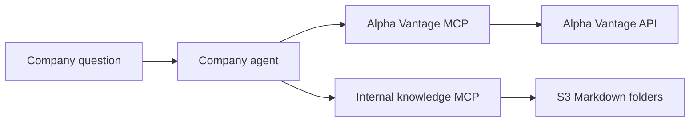

# Company analysis with AgentCore and MCP

Ask one agent about company financial performance and your internal research. It uses two independent MCP services: Alpha Vantage for financial data, and an S3-backed internal knowledge service for Markdown documents. All three services run on AWS Bedrock AgentCore.

[Run locally](docs/local.md) · [Internal knowledge MCP](internal-knowledge-mcp/README.md) · [FAQ](docs/faq.md)



Users receive live tool-start and completion events while the agent works; see
[the streaming event format](company-agent/README.md#live-tool-progress).

Each service has its own source, dependencies and infrastructure. Start with
`company-agent/agents/analyst.py` for the agent loop and `mcp_connections.py` for
its connections. Each MCP's `mcp_server/server.py` declares its tools; the data
access lives beside it. Adding a service follows this same pattern.

## Quick deploy

You need Git, Python 3.11+, uv, AWS CLI v2, Terraform 1.7+, and an AWS profile with deployment permissions and **Claude Sonnet 4.6** access. [Prerequisites and model check →](docs/faq.md#what-do-i-need-before-deploying)

This guide uses **eu-west-1** and builds images in AWS; no local Docker is needed. Start with synthetic IBM data, then enable live data. AWS charges apply.

### 1. Set up

Use one Bash shell and run the remaining commands from the cloned repository root. Replace `your-profile`; log in first if your profile uses SSO.

```bash
git clone https://github.com/weijianzhg/company-analysis-demo.git
cd company-analysis-demo
export AWS_PROFILE=your-profile
export AWS_REGION=eu-west-1
export AWS_DEFAULT_REGION="$AWS_REGION"
export TF_VAR_aws_region="$AWS_REGION"
aws sts get-caller-identity

cp company-agent/infra/terraform.tfvars.example company-agent/infra/terraform.tfvars
cp alpha-vantage-mcp/infra/terraform.tfvars.example alpha-vantage-mcp/infra/terraform.tfvars
cp internal-knowledge-mcp/infra/terraform.tfvars.example internal-knowledge-mcp/infra/terraform.tfvars
```

Set `knowledge_bucket` to your existing S3 bucket and `knowledge_prefix` to the
Markdown root folder in `internal-knowledge-mcp/infra/terraform.tfvars`. Use a bucket
in the deployment region. For the example below, upload the clearly labeled sample:

```bash
aws s3 cp internal-knowledge-mcp/examples/ s3://YOUR-BUCKET/knowledge/ --recursive
```

Use `knowledge_prefix = "knowledge/"` for that layout. See the
[knowledge guide](internal-knowledge-mcp/README.md) for your own files and KMS settings.

### 2. Create repositories and build images

Confirm the AWS account above, then review and approve each Terraform plan. Keep the example resource names unchanged.

```bash
terraform -chdir=alpha-vantage-mcp/infra init
terraform -chdir=company-agent/infra init
terraform -chdir=internal-knowledge-mcp/infra init
terraform -chdir=alpha-vantage-mcp/infra apply \
  -target=aws_ecr_repository.agent -target=aws_ecr_lifecycle_policy.agent \
  -target=aws_secretsmanager_secret.alpha_vantage
terraform -chdir=company-agent/infra apply \
  -target=aws_ecr_repository.agent -target=aws_ecr_lifecycle_policy.agent

terraform -chdir=internal-knowledge-mcp/infra apply \
  -target=aws_ecr_repository.agent -target=aws_ecr_lifecycle_policy.agent

terraform -chdir=cloud/build init
terraform -chdir=cloud/build apply
uv run --project company-agent/agents --frozen python cloud/build_images.py start --wait
```

After **all three builds succeed**, set `container_tag` in each service’s `infra/terraform.tfvars` file to the printed image tag.

### 3. Deploy both MCPs, then the agent

```bash
terraform -chdir=alpha-vantage-mcp/infra apply
terraform -chdir=alpha-vantage-mcp/infra output -raw agent_runtime_arn
terraform -chdir=internal-knowledge-mcp/infra apply
terraform -chdir=internal-knowledge-mcp/infra output -raw agent_runtime_arn
```

Copy the financial MCP ARN into `mcp_runtime_arn` and the knowledge MCP ARN into
`internal_knowledge_mcp_runtime_arn` in `company-agent/infra/terraform.tfvars`, then:

```bash
terraform -chdir=company-agent/infra apply
uv run --project company-agent/agents --frozen python cloud/test_end_to_end.py \
  --mode fixture --knowledge-path companies/IBM/research.md --require-tool-events
```

All endpoints require AWS IAM authentication. The initial test uses the real Bedrock model with **SYNTHETIC TEST DATA**.

## Use it

Ask a question with a ticker; each question starts a fresh analysis. Fixture mode supports IBM only.

```bash
uv run --project company-agent/agents --frozen python company-agent/scripts/invoke.py \
  --prompt "Analyze IBM's annual performance, revenue growth, margins, P/E and cash flow."
```

Ask about the internal sample, or combine both sources:

```bash
uv run --project company-agent/agents --frozen python company-agent/scripts/invoke.py \
  --prompt "Analyze IBM financial performance and summarize our internal hybrid cloud research. Cite the internal documents."
```

Internal documents are retrieved from S3 independently of the financial data mode.
For financial-only use, leave both internal MCP settings unset. Existing `MCP_URL`
and `MCP_RUNTIME_ARN` settings still select the financial service.

### Enable live data

Store your [Alpha Vantage API key](https://www.alphavantage.co/support/#api-key) using the hidden prompt:

```bash
uv run --project company-agent/agents --frozen python cloud/set_api_key.py
```

Set `alpha_vantage_mode = "live"` in `alpha-vantage-mcp/infra/terraform.tfvars`, then:

```bash
terraform -chdir=alpha-vantage-mcp/infra apply
uv run --project company-agent/agents --frozen python cloud/test_end_to_end.py \
  --mode live --allow-missing-overview
```

Use the same question command above. Quotes and all three financial statements are required; if overview access is unavailable, the agent says **P/E unavailable**. A cold snapshot takes about a minute. [Data limits and P/E →](docs/faq.md#why-is-pe-unavailable)

For direct MCP access, key rotation, updates, tests, or cleanup, see the [FAQ](docs/faq.md).

MIT licensed. Adapted from [bedrock-agent-blueprint](https://github.com/weijianzhg/bedrock-agent-blueprint/tree/c65654ff433f8e9cbc8b916a3a579497a93537dc). See [LICENSE](LICENSE).
