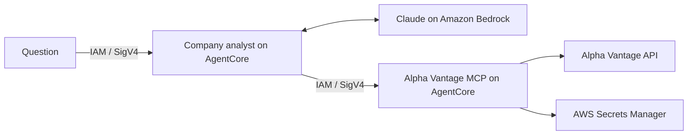

# FAQ

[Back to quick deploy and usage](../README.md)

## What do I need before deploying?

Install [Python 3.11+](https://www.python.org/downloads/), [uv](https://docs.astral.sh/uv/getting-started/installation/), [AWS CLI v2](https://docs.aws.amazon.com/cli/latest/userguide/getting-started-install.html), [Terraform 1.7+](https://developer.hashicorp.com/terraform/install), and Git.

Use a development AWS account with permission to manage AgentCore, Bedrock inference profiles, ECR, CodeBuild, S3, Secrets Manager, CloudWatch Logs, and their IAM roles/policies, including `iam:PassRole`. The quick deploy uses fixed resource names; ensure those names are unused.

For an IAM Identity Center / SSO profile, authenticate before deploying:

```bash
aws sso login --profile your-profile
```

With the profile and region selected as shown in the README, verify model access:

```bash
aws bedrock-runtime converse \
  --model-id eu.anthropic.claude-sonnet-4-6 \
  --messages '[{"role":"user","content":[{"text":"Say hello."}]}]' \
  --inference-config '{"maxTokens":32}' \
  --query 'output.message.content'
```

This must return a response. If access is denied, check Anthropic first-use requirements, Marketplace activation, IAM policies, and organization restrictions. See [Bedrock model access](https://docs.aws.amazon.com/bedrock/latest/userguide/model-access.html).

The Python commands use `uv run --frozen`, which installs the locked dependencies when needed. Cloud helpers accept `--profile`; otherwise they use `AWS_PROFILE` and the standard AWS credential chain.

## What does the demo deploy?



Three Terraform roots manage separate parts of the deployment:

| Root | Resources |
| --- | --- |
| `alpha-vantage-mcp/infra` | MCP runtime and IAM role, ECR repository, Alpha Vantage secret metadata |
| `company-agent/infra` | Agent runtime and IAM role, ECR repository, Bedrock application inference profile |
| `cloud/build` | Private encrypted S3 source bucket, ARM CodeBuild projects, build role and logs |

The agent gets financial data through MCP. Python calculates the financial metrics; the language model explains the returned figures. Each question starts a new analysis, so include the ticker each time.

## Why create repositories before deploying the runtimes?

The runtimes need container images, and the builds need existing ECR repositories. The targeted Terraform applies in the README bootstrap those repositories and the secret container. Full applies deploy the runtimes after both images are built. The secret can remain empty in fixture mode.

CodeBuild builds ARM64 images, so local Docker is not required. Uploads include only the source allowlists in `cloud/build_images.py`; dotenv files, Terraform state, Git history, and model downloads are excluded. Build source archives expire after seven days, and build logs have seven-day retention.

## How do I resume or troubleshoot an image build?

From the repository root, using the same AWS profile:

```bash
uv run --project company-agent/agents --frozen python cloud/build_images.py status --wait
```

The command reports each build's status and log link. Deploy the printed tag only after both builds succeed. The ignored `cloud/builds.json` records the latest tag, build IDs, and source hashes.

## Why start with synthetic data?

Fixture mode tests the complete AWS path without an Alpha Vantage key. Both AgentCore endpoints and the Bedrock model are real; the IBM financial inputs are synthetic and answers must say **SYNTHETIC TEST DATA**. Fixture mode supports IBM only.

Expected fixture metrics include 10% revenue growth, 15% net margin, P/E of 20, USD 15 billion free cash flow, and a 1.5 current ratio. Live provider failures never trigger an automatic switch to fixtures.

## Can I call MCP directly?

Yes, with an AWS identity allowed to invoke the MCP runtime. List its tools:

```bash
uv run --project alpha-vantage-mcp/mcp_server --frozen python alpha-vantage-mcp/scripts/mcp_client.py --list-tools
```

The six tools are `get_stock_quote`, `get_company_overview`, `get_income_statement`, `get_balance_sheet`, `get_cash_flow`, and `get_company_snapshot`. Each requires a ticker. Statement tools accept `period=annual|quarterly` and `limit=1..5`. The snapshot combines quotes, valuation, two annual statements of each type, and calculated metrics. See the [MCP README](../alpha-vantage-mcp/README.md).

## How are the endpoints authorized?

Both `DEFAULT` endpoints require AWS IAM authentication through SigV4. Use the provided signed clients to invoke them. Unsigned requests are rejected; these are API endpoints, not browser pages.

The agent signs MCP requests using its runtime role, whose policy permits invoking this MCP runtime and its `DEFAULT` endpoint. Caller identity is not propagated to MCP. The MCP role can read its own API secret; the agent has no access to the Alpha Vantage key. The `PUBLIC` network setting allows outbound internet access while IAM authenticates inbound calls. See [AWS's MCP hosting guide](https://docs.aws.amazon.com/bedrock-agentcore/latest/devguide/runtime-mcp.html).

## Where is the API key stored, and how do I rotate it?

The key is stored in AWS Secrets Manager and loaded only by the MCP service. Its value is excluded from Terraform, images, prompts, and Git. To set or rotate it:

```bash
uv run --project company-agent/agents --frozen python cloud/set_api_key.py
terraform -chdir=alpha-vantage-mcp/infra apply
```

The prompt hides the key. The helper records only its non-secret version ID in the ignored `alpha-vantage-mcp/infra/secret-version.auto.tfvars.json`. Applying Terraform updates the runtime so it loads the new key. For the first switch to live data, also set `alpha_vantage_mode = "live"` in that root's `terraform.tfvars` before applying.

For automation, read a private dotenv file containing `ALPHA_VANTAGE_API_KEY`:

```bash
uv run --project company-agent/agents --frozen python cloud/set_api_key.py \
  --env-file /absolute/path/to/private.env
```

## Why is P/E unavailable?

P/E and trailing EPS require Alpha Vantage's `OVERVIEW` endpoint. The key used in our live test returned an explicit premium-endpoint error. The agent therefore reports **P/E unavailable** and continues with the available statements. The public `demo` key also did not provide complete financial statements in our tests.

The README uses `--allow-missing-overview`. This permits only missing overview data: a live quote, all three financial statements, usable performance metrics, and an actual agent response using MCP are still required. When overview is missing, the snapshot remains `partial`, P/E metrics stay `null`, and the agent must disclose their unavailability. Missing quotes or statements still fail the test.

Omit the flag to require all five provider endpoints:

```bash
uv run --project company-agent/agents --frozen python cloud/test_end_to_end.py --mode live
```

Quote currency remains unknown when the provider does not supply it; statement currency is reported separately. Missing P/E is never estimated from annual net income. See [Alpha Vantage's documentation](https://www.alphavantage.co/documentation/) for endpoint coverage.

## Why can a response take a minute or more?

A snapshot makes up to five Alpha Vantage requests. Uncached live requests are spaced 15 seconds apart per MCP process, so a cold snapshot takes about a minute before model processing. Responses are cached for 15 minutes per process; cache hits and fixture requests do not wait.

`ALPHA_VANTAGE_REQUEST_INTERVAL` controls the spacing in seconds. Pacing does not coordinate quotas across runtime sessions or increase the provider's daily allowance. Provider errors are retained with API keys redacted. Respect the provider's quota window before retrying a rate limit.

Quotes represent the latest available trading-day data and are not guaranteed real time. Retrieval time does not change the quote's reported trading date.

## How are the financial calculations handled?

The MCP calculates metrics deterministically in [financials.py](../alpha-vantage-mcp/mcp_server/financials.py). Annual comparisons require compatible periods and currencies. Balance-sheet and cash-flow metrics must match the income statement's fiscal period and currency.

Free cash flow is `operatingCashflow - abs(capitalExpenditures)`. Cash-flow growth is calculated before the agent describes a trend. Liabilities/equity is kept distinct from debt/equity; provider trailing and forward P/E are kept separate from latest price divided by trailing EPS. Null values mean unavailable or not meaningful, including ratios with zero or negative denominators. Model-written explanations still need review.

## What has been tested?

On **2026-10-29**, the deployed live test passed with `--allow-missing-overview`: quotes and all three financial statements reached the real Bedrock agent through MCP. The agent reported P/E unavailable and correctly described the supplied cash-flow growth. Both endpoints rejected unsigned requests with HTTP 403. All **131 local tests** passed; an earlier complete cloud fixture test also passed.

The cloud test checks authentication, discovers all six tools, rejects an invalid ticker, verifies snapshot metrics, and obtains a real agent response using MCP. Account-specific evidence is written to the ignored `evidence/cloud/` directory. Live tests consume provider quota and incur AWS charges.

## How do I run or test locally?

From the repository root:

```bash
./test-local.sh
```

This starts temporary HTTP services and exercises the real Strands/MCP tool loop with a scripted test model and synthetic data. No AWS credentials or Alpha Vantage key are needed. It verifies the integration without making language-model inference calls.

For an interactive local demo using Bedrock or a local llama.cpp model, follow [local setup](local.md). The agent and MCP use separate locked Python environments because their MCP SDK versions differ.

## How do I update the deployment or change its configuration?

After changing source code, run the image build again, wait for both builds to succeed, and put the new `container_tag` in both runtime `terraform.tfvars` files. Apply the MCP root, then the agent root, and run the test for the active data mode. See [quick deploy](../README.md#quick-deploy) for the commands.

Persist `container_tag` and `mcp_runtime_arn` in those ignored files; stale values can revert a runtime image or MCP connection. Preserve the three Terraform state directories and use the same AWS profile/region. Configure a private remote state backend before sharing infrastructure management. State, plans, tfvars, build records, and test evidence are ignored by Git; provider and Python lockfiles are committed.

To change regions, set `aws_region` consistently in both runtime configurations and `TF_VAR_aws_region` for all roots. Choose an available Bedrock model, verify access, and update `model_id` in the agent configuration. Region/model combinations beyond the documented defaults have not been verified by this demo.

The build projects look up `company-agent-dev` and `alpha-vantage-mcp-dev`. If renaming them, also update `locals.projects` in `cloud/build/main.tf`. Multiple demos need distinct build buckets, roles, log groups, and project names. The blueprint's optional GitHub OIDC and remote-backend settings are not enabled by the quick deploy.

## What should I check when something fails?

| Symptom | Check |
| --- | --- |
| Bedrock `AccessDeniedException` | Run the model check above; verify model access, first-use requirements, Marketplace activation, IAM policies, and organization restrictions. |
| ECR repository not found | Complete the bootstrap applies and keep ECR names consistent with `locals.projects`. |
| CodeBuild fails | Run `build_images.py status`; follow its log links. Wait for both builds to succeed before deploying. |
| MCP cannot load its key or uses an old one | Run `set_api_key.py`, then apply the MCP Terraform root to load the new secret version. |
| Alpha Vantage quota/access error | Inspect `snapshot.errors`. Check key access and the quota window; the runtime does not fall back to fixtures. |
| A signed request receives 403 | Check the selected AWS profile and its permission to invoke that runtime/endpoint. Unsigned 401/403 responses are expected. |
| A new runtime is not ready | Check the runtime and `DEFAULT` endpoint in the AgentCore console. Wait for the endpoint to serve the updated runtime version; inspect runtime logs if startup failed. |
| Secret name unavailable after cleanup | Secrets have a seven-day recovery window. Restore and import the secret into Terraform, or wait before recreating that name. |

## How do I remove the deployment?

Using the same AWS profile and saved Terraform state, review and confirm these plans in order:

```bash
terraform -chdir=company-agent/infra destroy
terraform -chdir=alpha-vantage-mcp/infra destroy
terraform -chdir=cloud/build destroy
```

Development ECR images and build source objects are deleted with their resources. Secrets Manager has a seven-day recovery window. Runtime-created CloudWatch log groups may remain; remove the groups belonging to these runtimes if no longer needed.

## Where should I start reading the code?

| File | Purpose |
| --- | --- |
| [analyst.py](../company-agent/agents/analyst.py) | Model, prompt, and MCP tool loop |
| [cloud_mcp.py](../company-agent/agents/cloud_mcp.py) | IAM-signed MCP transport |
| [server.py](../alpha-vantage-mcp/mcp_server/server.py) | Six financial tools |
| [alpha_vantage.py](../alpha-vantage-mcp/mcp_server/alpha_vantage.py) | Provider requests, caching, pacing, and safe errors |
| [financials.py](../alpha-vantage-mcp/mcp_server/financials.py) | Financial formulas and missing-value handling |

The agent's generic invocation/build helpers are inherited from the blueprint. Use `scripts/invoke.py --prompt` for this demo; the generic CLI's workspace/file-management actions are not supported by the analyst runtime.
